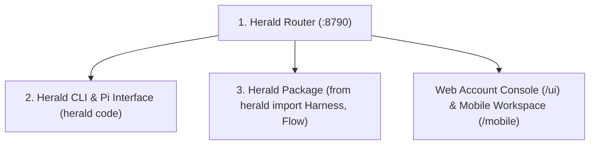

# Herald Component Reference: Router, CLI, and Package

Herald has three public parts that share the core **Router**:



---

## 1. Herald Router

The Router is the unified daemon powering all inference, tool execution, credential isolation, and autonomous coordination.

### Key Capabilities & Features

- **Multi-Protocol Wire Compatibility**:
  - `POST /v1/chat/completions` (OpenAI / ChatGPT / LM Studio compatible).
  - `POST /v1/messages` (Anthropic Claude protocol).
  - `POST /api/chat` & `POST /api/generate` (Ollama wire format).
- **Intelligent Routing Modes**:
  - `efficiency`: Automatically routes to free browser-session accounts or local GPU models, preserving paid/subscription quota.
  - `balanced`: Routes across healthy backends respecting cost and performance priorities.
  - `quality`: Directs complex tasks to top-tier reasoning and coding models.
  - `local`: Restricts all inference strictly to local Ollama / LM Studio models.
- **Budget Reservation & Forecasting (`herald.router.usage_budget`)**:
  - Predicts token and call burn-rate across 6-hour windows.
  - Enforces a hard reserve floor (default 30%) to prevent background automations from exhausting quota needed for trading agents or personal interactive use.
- **Governed Tool Execution & MCP Gateway**:
  - Built-in Model Context Protocol (MCP) server for filesystem, ripgrep, web search, and shell tools.
  - Granular MCP group access levels: `global`, `project`, `part`, or `cli` profile.

---

## 2. Herald CLI (`herald code` / Pi interface)

The interactive coding environment wraps and extends `@earendil-works/pi-coding-agent` with Herald's custom overlay (`herald/shell_assets/herald.ts`).

### Core Commands & Workflows

| Command | Purpose |
|---|---|
| `herald` / `herald code` | Launch the full-screen interactive coding terminal |
| `herald setup` | Launch the interactive configuration wizard |
| `herald status` | View health of all active model backends, GPU nodes, and MCP tools |
| `herald usage` | View unified live quota usage and reset countdowns across providers |
| `herald dashboard` | Open the Account Console web control plane in your browser |
| `herald ask "prompt"` | Run a one-off query through the optimal model |
| `herald tools` | List all discovered MCP tools and scoped capabilities |
| `herald schedule list` | View and manage cron / event-triggered background tasks |

### In-Session Slash Commands (`/`)
- `/model [mode|backend]`: Switch routing policy (`efficiency`, `quality`, `local`) or pin a backend.
- `/plan`: Engage plan mode for complex multi-step reasoning before making edits.
- `/accounts`: Manage active identities and logins.
- `/tools`: Inspect active tool catalog and execute direct tests.
- `/usage`: Live quota telemetry and burn projections.

---

## 3. Herald Package

The Python library allows any Python application, script, or framework to harness Herald's multi-model routing, tool execution, and persistent stateful memories.

### Basic Prompting & Router Client
```python
from herald import Router

client = Router("http://localhost:8790")
reply = client.chat("Explain quantum entanglement in 2 sentences", mode="efficiency")
print(reply)
```

### Stateful Agents with Encrypted Memory Cache
```python
from herald import Harness

app = Harness.open(".", name="code-auditor")
reviewer = app.agent(
    "SecurityReviewer",
    memory="security-audit-2026",
    instructions="Flag potential vulnerabilities and insecure dependencies.",
)

decision = reviewer.decide(
    question="Is this code safe for production?",
    options=["approve", "needs-fixes", "reject"],
    context="import os; os.system(user_input)",
)

print(f"Choice: {decision.choice}, Reason: {decision.reason}")
```

### Multi-Agent Autonomous Flows (`Flow`)
```python
from herald import Flow, Harness

flow = Flow("feature-pipeline", mode="efficiency")
director = flow.agent("Director", "auto", memory="director")
researcher = flow.agent("Researcher", "auto", memory="research")
reviewer = flow.agent("Reviewer", "auto", memory="review")

# Pipeline: Director -> Parallel (Researcher, Reviewer) -> Director -> output
flow.then(director).then(researcher, reviewer).then(director).then("output")

result = Harness.open(".").run_flow(flow, "Implement real-time WebSocket telemetry")
print(result["content"])
```
