```mermaid
graph TD
    subgraph Standalone["1. Standalone Single-Device Setup"]
        SingleDev["Laptop / PC (All-in-One)"]
        SingleDev --> LocalRouter["Local Herald Router (:8790)"]
        SingleDev --> LocalCLI["herald code / Pi Terminal"]
        SingleDev --> LocalSDK["Python SDK / Scripts"]
        LocalRouter --> LocalOllama["Local Ollama / LM Studio"]
        LocalRouter --> CloudAPIs["Cloud Providers (OpenAI, Gemini, etc.)"]
    end

    subgraph ClientServer["2. Client / Server Topology (Headless Router)"]
        ServerBox["24/7 Home Server / Cloud VPS"]
        Workstation["Laptop / Workstation"]
        
        ServerBox --> ServerRouter["Headless Herald Router (:8790)"]
        ServerBox --> Schedulers["Scheduled flows and background agents"]
        ServerBox --> SharedVault["Encrypted Memory & Vault"]
        
        Workstation --> RemoteCLI["herald code (Pi Terminal)"]
        Workstation --> RemoteSDK["Python SDK (from herald import Harness)"]
        RemoteCLI -. "HERALD_URL=http://server:8790" .-> ServerRouter
        RemoteSDK -. "HTTP API" .-> ServerRouter
    end

    subgraph MultiDeviceMesh["3. Distributed Multi-Device Mesh (GPU Compute Streaming)"]
        GPUBox["Compute Rig (Gaming PC / GPU Box)"]
        HubServer["Router Hub (Home Server / Tailscale Node)"]
        MobileWorkstation["Client Laptop / Mobile"]
        
        GPUBox --> LocalOllama2["LM Studio / Ollama / GPU"]
        GPUBox -. "LAN / Tailscale Stream" .-> HubServer
        HubServer --> HubRouter["Herald Router Engine (:8790)"]
        HubRouter --> MultiCloud["Cloud APIs + Vault + Budget Watcher"]
        MobileWorkstation -. "HERALD_URL" .-> HubRouter
        MobileWorkstation --> WebMobile["Mobile Web UI (:8790/mobile)"]
    end
```

# Herald Router Deployment Topologies

Herald is designed to operate across three deployment topologies depending on your hardware, network, and use cases.

---



---

## 1. Standalone / Single-Device Setup

**Best for**: Developers working entirely on one machine with local models or API keys.

### Installation
```bash
# macOS / Linux
curl -fsSL https://raw.githubusercontent.com/KianJRoss/herald-release/main/install.sh | bash

# Windows PowerShell
irm https://raw.githubusercontent.com/KianJRoss/herald-release/main/install.ps1 | iex
```

### Configuration
1. Run `herald setup` and select **[1] Standalone / Local Device**.
2. Herald will automatically detect running **Ollama** (`http://localhost:11434`) or **LM Studio** (`http://localhost:1234`) instances.
3. Add any cloud API keys (OpenAI, Anthropic, Gemini, OpenRouter) or enter them in `~/.herald/.env`.
4. Launch the interactive environment:
   ```bash
   herald code
   ```

---

## 2. Client / Server Topology (Headless Server Hub)

**Best for**: Running scheduled flows, background agents, and persistent memory on a 24/7 home server or cloud instance while coding from a laptop.

### Server Setup
1. On your headless server:
   ```bash
   curl -fsSL https://raw.githubusercontent.com/KianJRoss/herald-release/main/install.sh | bash
   export HERALD_API_KEY="$(python -c 'import secrets; print(secrets.token_urlsafe(32))')"
   # Non-loopback binding is rejected unless HERALD_API_KEY is set.
   herald start --host 0.0.0.0 --port 8790 --foreground
   ```
2. Store the same `HERALD_API_KEY` in the client environment, then run
   `herald setup` and select **[3] Headless Server Hub**.

Keep the Router on a trusted LAN or private mesh and use TLS at a reverse proxy
when traffic crosses an untrusted network. The API key authenticates the
application; it does not encrypt network traffic.

### Client Workstation Setup
1. On your laptop:
   ```bash
   curl -fsSL https://raw.githubusercontent.com/KianJRoss/herald-release/main/install.sh | bash
   herald setup
   # Select [2] Client Workstation and enter your server URL (e.g. http://192.168.1.100:8790)
   ```
2. Your laptop commands (`herald code`, `herald ask`, and the Python SDK) now route all inference, tool execution, and memory storage to the server.

---

## 3. Distributed Multi-Device Mesh (Dedicated GPU Streaming)

**Best for**: Streaming heavy local models from a dedicated GPU gaming rig into a 24/7 server hub, and accessing everything from a laptop or mobile phone.

### Network Setup (Recommended: Tailscale or LAN)
- Install [Tailscale](https://tailscale.com) on all devices or connect them over your local network.
- Create `~/.herald/fleet.yaml` (or point `HERALD_FLEET_CONFIG` at one) to name aliases for your devices:
  ```yaml
  devices:
    gpu-rig:
      primary_alias: gpu
      aliases: [gpu, desktop]
      user: yourusername
      os: windows
    home-server:
      primary_alias: server
      aliases: [server, hub]
      user: serveruser
      os: linux
  ```

### Compute Rig (Gaming PC / GPU Node)
1. Start Ollama (`OLLAMA_HOST=0.0.0.0:11434`) or LM Studio with the local server enabled on port `1234`.

### Server Hub
1. Register the GPU node's model stream into Herald's registry:
   ```bash
   herald connect lmstudio --base-url http://gpu-rig:1234/v1
   # Or Ollama:
   herald connect ollama --base-url http://gpu-rig:11434
   ```

### Client Devices & Mobile
- Open `http://<server-ip>:8790/mobile` from your phone or tablet for an interactive coding terminal and voice conversation interface.
- Open `http://<server-ip>:8790/ui` for the Account Console dashboard.
